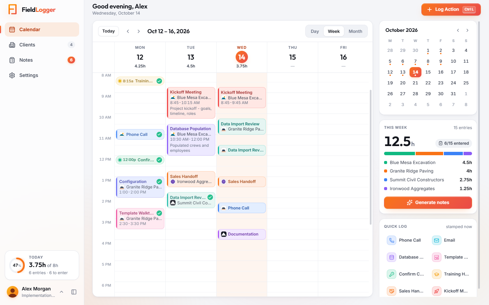
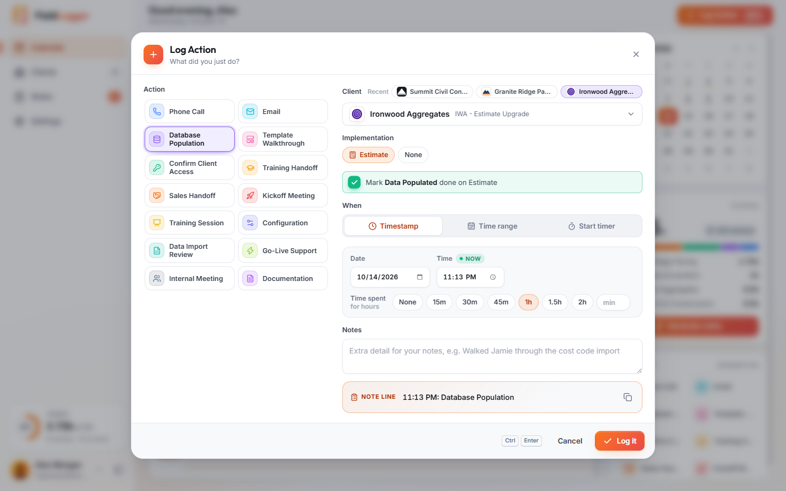
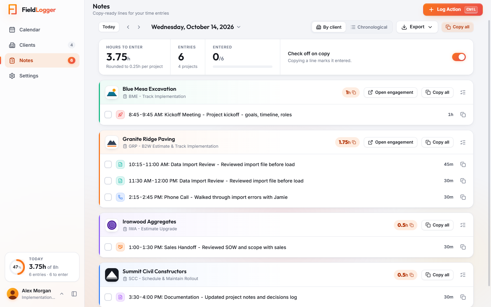
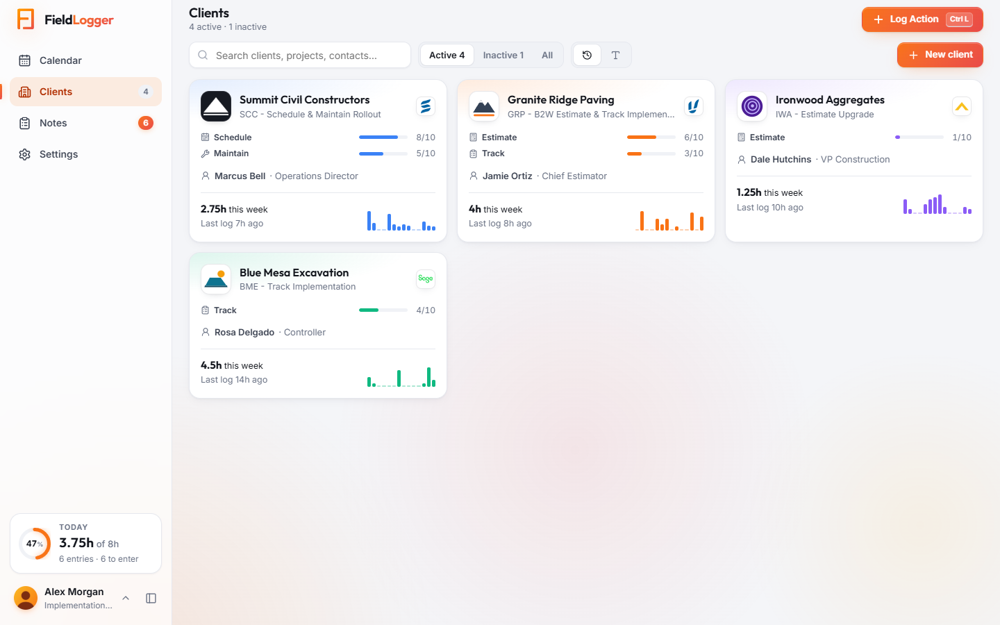
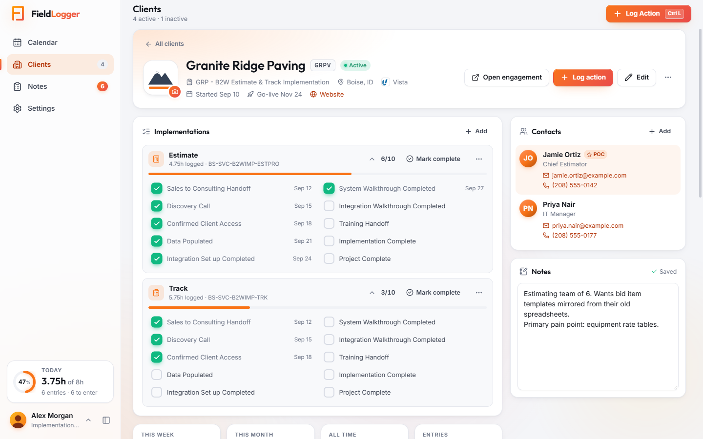
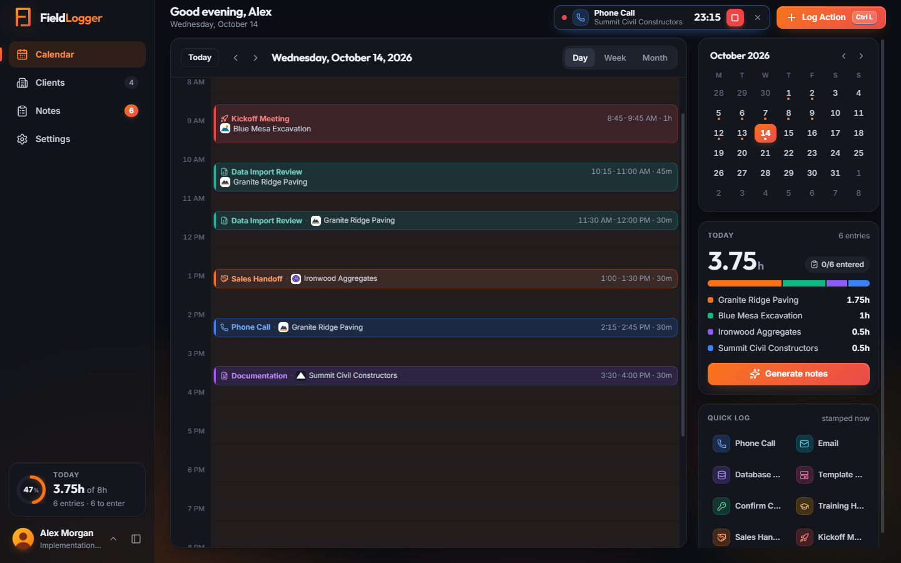

<p align="center">
  
</p>

<h1 align="center">FieldLogger</h1>

<p align="center"><b>Log it in the field. Copy it into your notes.</b></p>

<p align="center">
  A local Windows desktop app for implementation consultants: log every call, email and walkthrough in one click,<br>
  track each client's implementations and milestones, and get copy-ready note lines for your time entries.
</p>

<p align="center">
  
</p>

```
2:15 PM: Phone Call - Walked Jamie through the cost code import
10:00-11:30 AM: Template Walkthrough - Bid item templates with estimators
```

Everything stays on your computer. There's no server, no cloud and no sign-up.

## Contents

- [Features](#features)
- [Install (for colleagues)](#install-for-colleagues)
- [Updates](#updates)
- [Using it](#using-it)
- [Your data is safe](#your-data-is-safe)
- [Where data lives](#where-data-lives)
- [Developing](#developing)

## Features

### Log in one click

**Log Action** (`Ctrl+L`) is a single dialog: pick what you did, the client and when. Log it as a time stamp, a time range,
or a live timer that runs in the top bar while you work. **Quick log** buttons in the calendar's side panel log an action
in one click, and you can click and drag on the calendar to log a past time range.

When the client has implementations, Log Action asks which one the work is for and picks it for you when there's only
one in progress. Actions that count toward a milestone (Database Population → *Data Populated*, Template Walkthrough →
*System Walkthrough Completed*, and so on) offer to tick that milestone as you log, dated the day of the work.

<p align="center"></p>

### Copy-ready notes

The **Notes** page turns each day's entries into note lines, grouped by client (or in time order). Copy one line, a whole
project or the whole day. Hours are rounded per project the way time entries work, and each line can be checked off as
you enter it (or automatically when you copy it). The line format is yours to change with tokens like `{time}`,
`{event}`, `{notes}` and `{hours}`. Export a day, week or month to CSV.

<p align="center"></p>

### Clients, implementations and milestones

Each client card shows its implementations' progress, its ERP system and this week's hours at a glance.

<p align="center"></p>

On the client page you track each implementation (**Estimate**, **Track**, **Schedule**, **Maintain** and
**Field Employee**) against its ten plan milestones, from *Sales to Consulting Handoff* to *Project Complete*.
Ticking a milestone records the date, each implementation shows the hours logged against it, and **Mark complete**
folds it away when it's done. The page also holds the client's customer code (like `WARD`), ERP system (Vista,
Spectrum, Sage 100/300/50, QuickBooks, Foundation, ComputerEase or your own), contacts with a starred POC, an
engagement link, free-form notes and the full activity history.

<p align="center"></p>

### Make it yours

Light, dark or follow Windows; Trimble and B2W brand palettes, 12 accent colors or your own; a Trimble Gray dark mode;
your own action types with icons, colors, typical durations and milestone links. Profiles are local, with an optional PIN
that unlocks as soon as you type it.

<p align="center"></p>

## Install (for colleagues)

1. Get `FieldLogger-Setup-<version>.exe` from the team update folder (or however it was shared with you).
2. Windows may show **"Windows protected your PC"** because the app isn't code-signed. Click **More info → Run anyway**.
3. Click through the installer (no admin rights needed). A **FieldLogger** shortcut is added to your desktop and Start menu.
4. Create your profile. You just need a name; a PIN is optional.

## Updates

FieldLogger checks the team update folder when it starts and every few hours. When a new version is there, a banner shows
what changed; **Update now** saves your work, checks the installer, installs it and reopens FieldLogger. Pick or change the
folder, or check right away, in **Settings → Updates**. If you were sent an installer directly, running it updates
FieldLogger in place and keeps your data.

**To publish a version:** bump `version` in `package.json`, add its entry to `src/lib/changelog.js` (it appears in
**Settings → Updates** and in the update banner), run `npm run build`, then `npm run publish-update`. That copies the
installer to the folder in `fieldlogger.updateFolder` in `package.json` (or pass one:
`npm run publish-update -- "D:\Shared\FieldLogger"`) and writes `latest.json` with the version, notes and a SHA-256 checksum.

## Using it

| Do this | How |
| --- | --- |
| Log something you just did | **Log Action** (`Ctrl+L`), pick the action and client, then **Log it**. It's time-stamped now. |
| Log a past time range (2-3 PM) | Choose **Time range** in Log Action, or click and drag on the calendar |
| Time a call while it happens | Choose **Start timer**. It runs in the top bar; hit stop when you're done |
| One-click logging | **Quick log** buttons in the calendar side panel |
| Copy notes | **Notes**: copy one line, a whole project, or the whole day |
| Track what's been entered | Tick the checkbox per line, or leave **Check off on copy** on |
| Clients, POCs, notes | **Clients**: set a customer code (like WARD) and ERP system, add contacts (star one as POC), write notes, mark active/inactive |
| Implementations | Pick Estimate, Track, Schedule, Maintain and/or Field Employee for a client, tick off each one's milestones on the client page, and **Mark complete** when it's done |
| Milestones from logged work | Link an action type to a milestone in **Settings → Action types**; logging it against an implementation offers to tick that milestone |
| Client logos | Click (or drop an image on) the client's tile, or paste one with `Ctrl+V` in Edit client. The logo then shows in Log Action, on the calendar and in Notes |
| Engagement link | Paste the client's Salesforce DX engagement URL in **Edit client** to get an **Open engagement** button on the client page and in Notes |
| Profile picture | **Settings → Profile & PIN**: click, drop or paste a photo |
| Staying signed in | FieldLogger reopens straight into your profile. With a PIN, it asks for the PIN on launch (turn that off in Settings). **Lock** keeps your profile selected; **Switch profile** returns to the picker |
| Make it yours | **Settings → Appearance** for light/dark/system mode, the **Trimble** and **B2W** brand palettes, 12 accent colors or a custom one, the Trimble Gray dark mode, aurora glow and density |
| Change the note format | **Settings → Notes**. Tokens: `{time} {event} {notes} {client} {project} {code} {implementation} {duration} {hours} {date}` |
| See what changed | **Settings → Updates** lists every version's changes |

Shortcuts: `Ctrl+L` log · `Ctrl+1-4` switch pages · `T` today · `←/→` move · `D/W/M` day/week/month · `Esc` close · `Ctrl+Enter` save.

## Your data is safe

- **Saves can't half-happen.** Every save goes to a temporary file first and replaces the old one in a single step.
- **Copies are kept automatically:** one per profile from each of the last 14 days, the version before your last save,
  and a full copy of the data folder taken the first time each new version opens it.
- **One-click restore.** **Settings → Data & backup** lists every copy with its date and number of clients and entries.
  Restoring keeps your current data as a copy first.
- **Unreadable data is never overwritten.** If a profile's file ever can't be read, FieldLogger opens nothing and changes
  nothing; it offers to restore a backup and keeps the unreadable file aside.
- **No downgrades.** Data saved by a newer version opens read-only in an older one, so it can't be overwritten.
- **Updates and uninstalls never touch your data folder.** Deleting a profile moves its data into backups instead of erasing it.

The PIN is a lock screen, not encryption, so don't store passwords in client notes.

## Where data lives

`%APPDATA%\FieldLogger\data\`

- `profiles.json`: the list of local profiles (PINs are stored hashed)
- `profiles\<id>.json`: one file per profile with clients, entries and settings
- `backups\`: the daily copies, `<id>-previous.json`, `pre-update-*` folders (last 5) and deleted profiles

Use **Settings → Data & backup** to export or import a `.json` backup, for example when moving to a new laptop.

## Developing

The project can carry its own portable Node.js in `.tools\node` (any Node 22+ on `PATH` works too). In PowerShell:

```powershell
$env:Path = "$PWD\.tools\node;" + $env:Path
npm install                           # first time only
node node_modules/electron/install.js # first time only: downloads the Electron binary
npm start                             # run the app
npm run build                         # build dist\FieldLogger-Setup-<version>.exe
```

| Path | What it is |
| --- | --- |
| `main.js` | Electron main process: window, file storage, backups, updates, IPC |
| `preload.js` | The small API the UI is allowed to call |
| `src/app.js` | UI entry: theme engine, shortcuts, tooltips |
| `src/components/` | Calendar, Log Action, Clients, Notes, Settings, Backups, Updates, launch screen |
| `src/lib/` | Store, data versions and migrations, time math, note formatting, changelog, sample data |
| `src/vendor/` | Preact, htm, Lucide icons and fonts (refresh with `npm run vendor`) |
| `assets/` | `logo.svg`, the generated `icon.png`/`icon.ico` (`npm run icon`) and ERP logos in `erp/` |
| `erp_logos/` | Source ERP logos; `npm run erp-logos` trims them into `assets/erp/` |
| `docs/screenshots/` | The images in this README (`npm run snap` renders them into `.snaps/` with sample data) |
| `scripts/` | Vendoring, icon and ERP-logo rendering, screenshots, `publish-update`, browser preview (`npm run preview`) |

**Releasing:** every user-facing change bumps `version` in `package.json` and adds a matching entry at the top of
`src/lib/changelog.js`. Changing the shape of saved data means bumping `DATA_VERSION` and adding a migration step in
`src/lib/defaults.js`.

**Renaming the app:** change `APP_NAME` in `src/lib/defaults.js` and `productName` in `package.json`. The data folder is
pinned separately (`DATA_FOLDER` in `main.js`), so a rename never strands anyone's logs.

**End-to-end check:** set `FIELDLOGGER_SELFTEST=1` and `FIELDLOGGER_USER_DATA` to a scratch folder, then run the app.
It exercises profiles, PINs, saving and loading, backups and restore, and update checks through the real file store,
prints `SELFTEST PASS` or `FAIL`, and quits.
